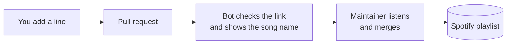

<h1 align="center">🎧 Open Source Mixtape</h1>

<p align="center">
  A Spotify playlist anyone can contribute to.<br />
  Open a pull request to add a song. Once it's merged, it goes live on Spotify automatically.
</p>

<p align="center">
  <a href="https://open.spotify.com/playlist/6RrEtS1qX6csamOV6ET74Q"></a>
  <a href="https://github.com/keito118/open-source-mixtape/actions/workflows/validate.yml"></a>
</p>

---

## Add a song

No Git knowledge needed. You can do it all in the browser.

1. In Spotify, open the song and choose **Share → Copy Song Link**.
2. Open [`playlists/open-source-mixtape.txt`](./playlists/open-source-mixtape.txt) and click the ✏️ pencil icon. GitHub makes a copy (fork) for you.
3. Add one line **at the end** of the file: the link, then `# Artist - Title`.

   ```text
   https://open.spotify.com/track/4uLU6hMCjMI75M1A2tKUQC  # Rick Astley - Never Gonna Give You Up
   ```

4. Click **Commit changes → Propose changes → Create pull request**, and tell us why you picked it.

A bot checks your link right away. When the pull request is merged, the song shows up in the [Spotify playlist](https://open.spotify.com/playlist/6RrEtS1qX6csamOV6ET74Q) within a minute or two.

## Guidelines

- Up to **3 songs** per pull request, so each one gets listened to.
- No duplicates. The check fails if the song is already in the playlist.
- Any genre, any language, any country. Songs that would make a stranger hit replay are perfect.
- Every pull request is reviewed by ear. Not every song will make it, and that's okay.

See [CONTRIBUTING.md](./CONTRIBUTING.md) for details.

## How it works



The playlist file is the source of truth. On every merge, GitHub Actions makes the Spotify playlist match it exactly, in the same order.

This repository runs on [**spotify-playlist-as-code**](https://github.com/keito118/spotify-playlist-as-code). Use that template to start a playlist like this with your own friends.

## 日本語

誰でも曲を追加できる Spotify プレイリストです。[`playlists/open-source-mixtape.txt`](./playlists/open-source-mixtape.txt) の最後に曲のリンクと `# アーティスト - 曲名` を1行足してプルリクを送ってください。マージされると Spotify のプレイリストに自動で反映されます。ブラウザだけで完結します。

## License

[MIT](./LICENSE)
